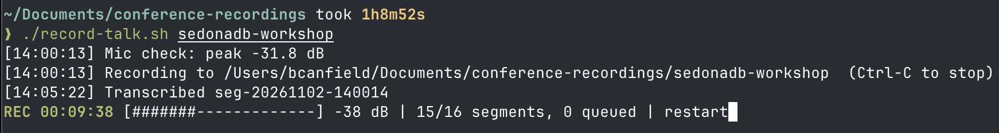

# talk-recorder

### Talk recording and local transcription for macOS



```sh
brew install ffmpeg whisper-cpp
./record-talk.sh my-talk
```

Press Ctrl-C to stop, then wait while it finishes your transcript, `my-talk/transcript.txt`.
